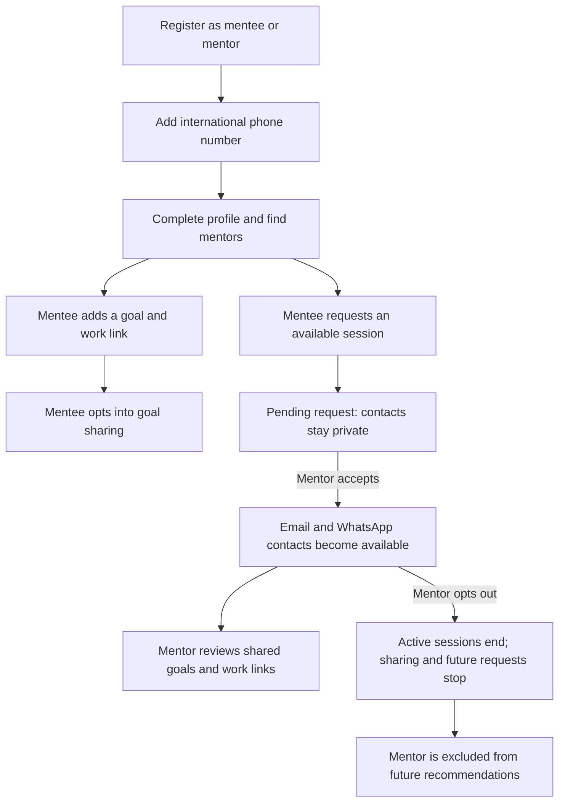

# MentorMatch Frontend

React, Vite, and Tailwind CSS frontend for the MentorMatch API.

## Run locally

Start the backend from the `backend` directory:

```bash
./run_local.sh
```

`run_local.sh` uses the local SQLite database `mentor_match_local.db`, applies
pending Alembic migrations, and starts FastAPI on `http://localhost:8000`. It
seeds demo accounts only when that database is first created. Existing local
data is kept. To deliberately seed demo data again, use `./run_local.sh --seed`;
this resets the shared demo-account passwords and adds any missing demo records.
To provision a local administrator, use `./run_local.sh --bootstrap-admin` and
follow its prompts.

In a second terminal, start the frontend:

```bash
cd ../new-frontend
npm install  # first run only
npm run dev
```

Open <http://localhost:5173>. Vite proxies API requests to the backend on port
8000. No frontend `.env` file is needed for local development.

## Main project flow



Goal sharing is a separate mentee choice. Only opted-in goals are visible to a
mentor after an accepted or completed session. Mentees can add or change links on
existing goals from the Goals screen. Opt-out is a one-way action in the current
flow; it cancels active sessions and disables future requests for that pair.

## Local feature test

Use fresh registered accounts for the contact flow. Seeded demo accounts have no
real phone numbers; use them for profile matching, availability, and admin
navigation instead.

1. Register one mentee and one mentor with international phone numbers beginning
   with `+` (for example, `+254 712 345 678`).
2. Sign in as the mentor, complete the profile, and publish a one-hour opening.
3. Sign in as the mentee, add a goal with a work link, and opt into sharing it.
   Existing goals with no link can be updated from the same screen.
4. Request the mentor's opening. Confirm the pending session has no contact
   actions, then accept it from the mentor account.
5. Confirm both session participants can use the email and WhatsApp actions and
   the mentor can open the shared work link.
6. Opt out from the mentor account. Confirm the session shows the opt-out state,
   contact actions and shared goals disappear, and another request is rejected.
7. For admin checks, provision a local admin with `--bootstrap-admin`, then try
   account search, role/status filters, suspension, and reactivation.

Existing accounts created before phone capture was added should enter their
number in **My profile** before testing WhatsApp contact. Migrated goals without
links can be updated from the mentee's Goals screen.

Run the backend's automated test suite from `backend`:

```bash
./.venv/bin/python -m unittest discover -s tests
```

Run `npm run build` from `new-frontend` to verify the production bundle.

The local demo password is `MentorMatchDemo2026!`. It is only for seeded local
accounts; do not use it for real accounts.

## Build

```bash
npm run build
npm run preview
```

## Production setup notes

Do not use `run_local.sh` or `--seed` for production. Configure the backend
database URL, signing secret, and allowed frontend origin; apply reviewed
migrations and provision an administrator deliberately. A separately hosted
frontend needs `VITE_API_BASE_URL` set to the API origin and matching backend CORS
configuration. Back up and rehearse database restoration before production
migrations.

See [`../backend/backend.md`](../backend/backend.md) for API details, database
migrations, and the guarded workflow for adopting older unversioned databases.
